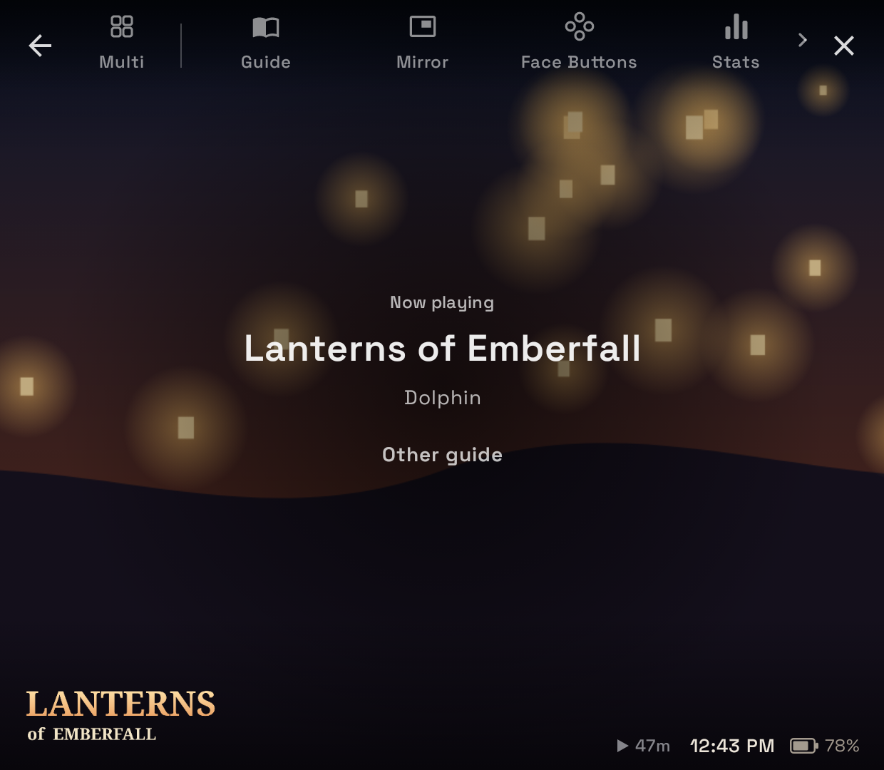
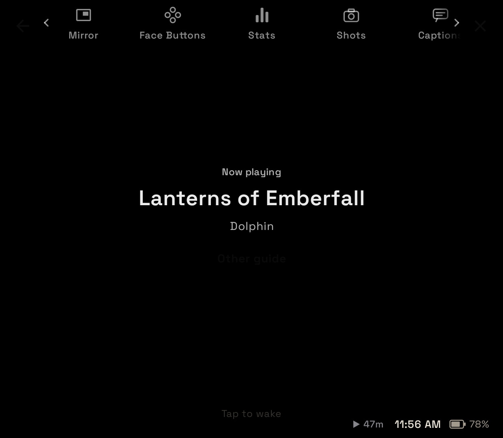
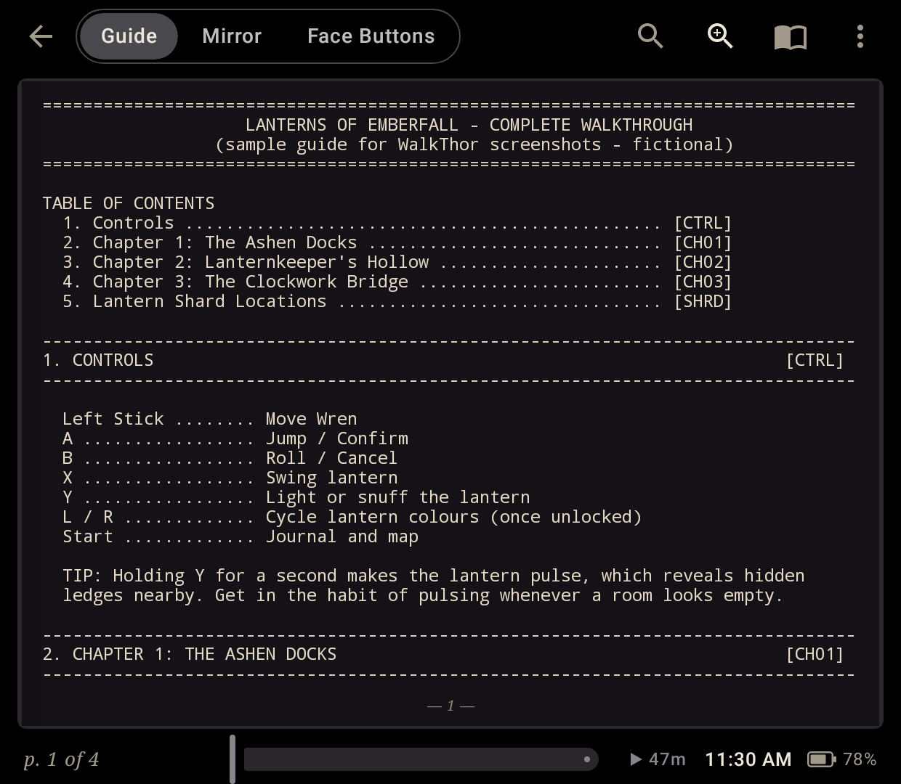
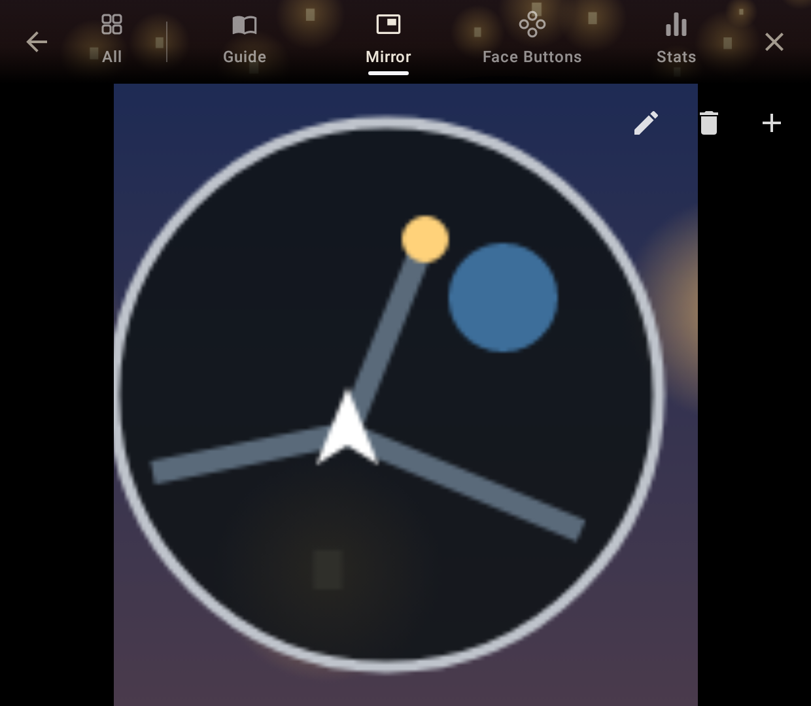
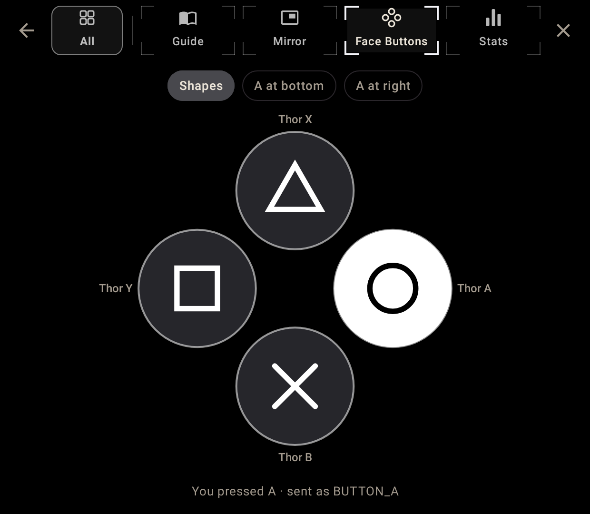
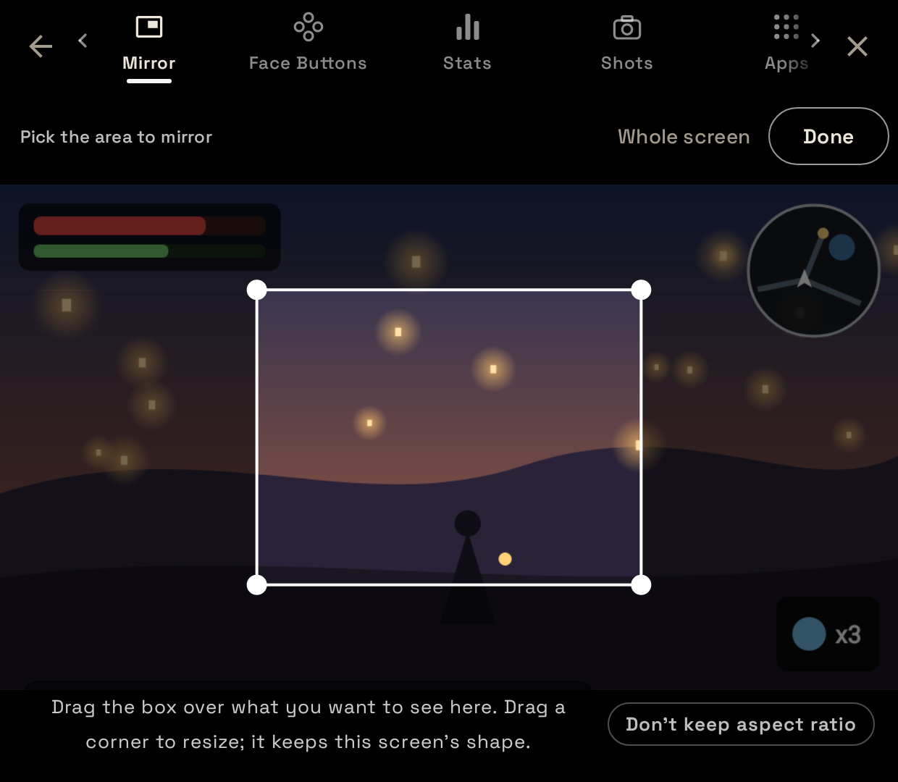
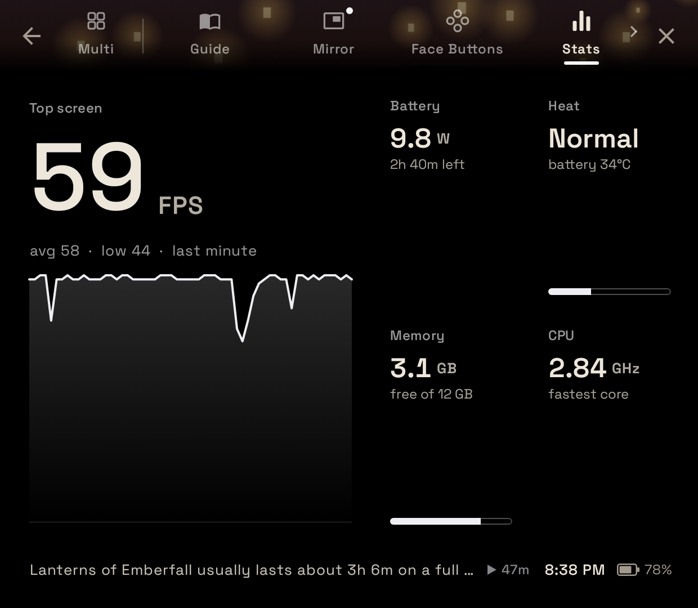
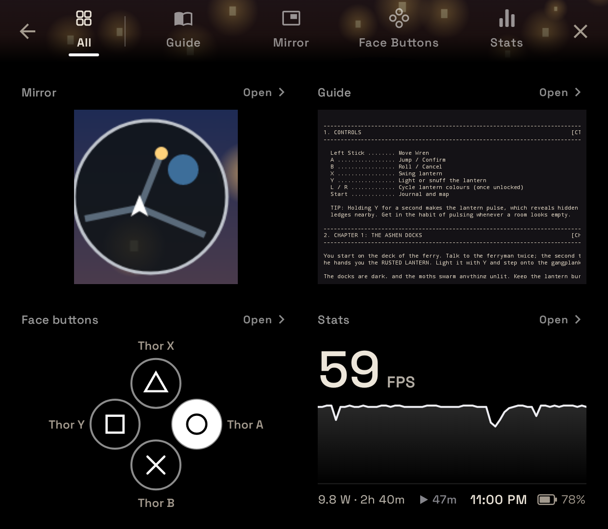
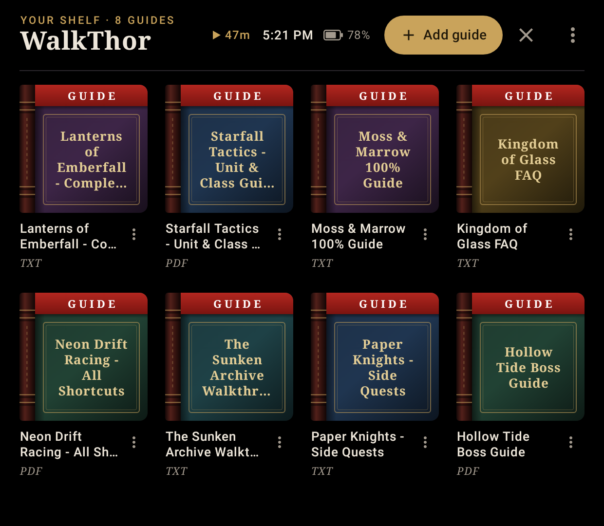
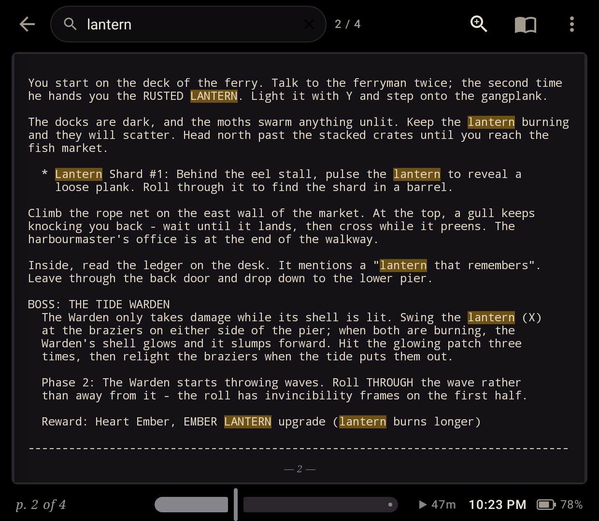

# WalkThor

A companion app for the **AYN Thor**'s bottom screen. Start a game in Cocoon and the bottom
screen becomes that game's companion: its guide, a live mirror of part of the top screen (like a
minimap), its face buttons the way the game labels them, and a live FPS and battery monitor, all
one tab away, while the game keeps full speed on the top screen.

> **WalkThor is an independent, unofficial project.** It is not affiliated with, endorsed by or
> supported by Cocoon or its developer, AYN, or any game publisher. It works alongside Cocoon by
> reading a log file Cocoon writes, nothing more.

## Screenshots

Rendered at the Thor bottom screen's 1240×1080 with a fictional sample game and guide.

| | |
|---|---|
|  |  |
|  |  |
|  |  |
|  |  |
|  |  |

## Quick start

1. **Install** the APK from the [latest release](https://github.com/nerf-herder-29/WalkThor/releases/latest)
   (allow "Install unknown apps" for your browser or file manager).
2. **Add a guide:** *Add guide* in your library, or *Open with* / *Share* a PDF or TXT from a file manager.
3. **Link Cocoon's folder** (the one with `launch_debug.log`) so WalkThor knows which game you started.
4. **In Cocoon, choose WalkThor as the companion app** for the bottom screen.
5. **Allow accessibility access** when WalkThor asks. It's what keeps the game at full priority
   (and lets you swipe WalkThor up and down).

Optional: link your artwork folder (Cocoon's media folder works) for game art, logos and guide
covers. Every step is also in the app under Settings (⋮) → About → *How to set up WalkThor*, with a tick for each
step that's done.

## Features

- **Now playing** — start a game in Cocoon and the bottom screen shows the game's hero art and
  logo, the emulator, and tabs across the top: **Multi** (several at a glance), **Guide**,
  **Mirror**, **Face Buttons**, **Stats** and **Apps** (swipe the tabs sideways to see them all). Switching tabs keeps your place in each, and Back takes you to Now playing.
  Press and hold a tab to have that game open straight on it next time.
- **Knows your game** — WalkThor reads Cocoon's `launch_debug.log`, or ES-DE's `logs/es_log.txt`
  (with ES-DE's *Custom Event Scripts* and *Debug Mode* on), to see what you launched and
  picks the guide whose title matches. Pick a different one once and it's remembered for that game.
- **Opens when an emulator starts** — turn on *Open when an emulator starts* (Settings → Emulators) and
  WalkThor opens on the bottom screen whenever an emulator comes to the front, from any frontend.
  With Cocoon linked it knows the game and its art from Cocoon as usual. Without Cocoon it asks
  *What are you playing?*, offering the games in your ROMs folder for that emulator's systems and
  your guides (your last picks first), or picks by itself when the emulator shows a matching name.
- **Your library** — with a ROMs folder linked, the library shows your games as covers, by
  system folder down the left (with All games and your Guides). Games with a guide are tagged;
  tap one to open its guide, or add or pick one. Long-press a game to choose its cover, its
  background on Now playing and its marquee: yours first, then Cocoon's artwork, then scraped art.
- **Artwork scraping** — add a ScreenScraper account and/or a SteamGridDB API key (Settings →
  Artwork → *Scraper accounts*) and WalkThor scrapes box art for your guides' covers, and a
  screenshot and marquee for each game, shown on Now playing, the splash and behind the tabs. A
  game Cocoon starts that has no art yet is looked up once on its own. Optionally link your ROMs
  folder (one folder per system: `3ds`, `nds`, `gba`, `switch`…) for exact matches. Release builds can carry
  ScreenScraper developer credentials from the `SCREENSCRAPER_DEV_ID` / `SCREENSCRAPER_DEV_PASSWORD`
  repository secrets; otherwise users enter their own.
- **Keeps your game at full speed** — while a game runs, WalkThor never takes Android's top-app
  priority from it. Tapping and reading on the bottom screen leave the game in charge, and after
  WalkThor opens (or you finish a search) it hands priority back with one tap on the top edge of
  the game's screen.
- **Comes back if a heavy game pushes it out** — some demanding games make Android close other
  apps to free memory while they load. If that closes WalkThor during a game, it reopens on the
  bottom screen right away and hands the game its priority back (Settings → About → *About & licences* →
  Diagnostics shows when this happened).
- **Mirror** — show part of the top screen, like a minimap or HUD, live on the bottom screen. The
  picking box keeps the bottom screen's shape so the mirror fills it (or resize it freely). Pick
  up to four areas per game, switch between them or see them all side by side, and WalkThor
  remembers them. Uses Android's screen capture (it asks the first time you open Mirror for a
  game, and pauses while you're on another tab); nothing is recorded or saved.
- **Face Buttons** — the four face buttons labelled the way the game's system labels them
  (shapes, or letters with A at the bottom or on the right), picked automatically from the
  emulator, each where its Thor button sits and lighting up as you press it.
- **Multi** — up to four tabs at once: choose from Mirror, your guide where you left off, Face
  Buttons, Stats and your pinned apps (⋮ → *Choose panels*). Tap a panel to open that tab; Back
  returns to Multi. Press and hold a panel and drag it to rearrange them.
- **Apps** — open any app on the bottom screen without leaving the game: Discord, a browser, a
  video. Pin the ones you use most; press and hold an app to open it on the top screen instead.
- **Stats** — the top screen's frame rate with a graph of the last minute (counted from the same
  screen capture as Mirror, so no root or extra apps), the battery's power draw and time left at
  that rate, heat, free memory and CPU speed. It learns how much power each game uses and tells
  you how long that game usually lasts on a full charge.
- **Import PDF or TXT guides** — from *Add guide*, a file manager's *Open with*, or *Share*.
  Guides are copied into the app, so the original file can be moved or deleted.
- **Animated book** — pages turn in 3D around the spine. Drag a page and it follows your finger;
  tap the outer edges to turn. Single page or two-page spread (top bar, or ⋮ during a game).
  - PDFs default to a two-page spread; TXT guides to a single wide page sized to 80 columns so
    GameFAQs-style ASCII tables stay aligned. Text size is adjustable.
- **Reading lens** — the magnifying-glass-with-plus button (or tapping the middle of a page) shows
  the page fit to the full width, zoomable to 500% with − / +, pinch or double-tap.
- **Magnifier loupe** — press and hold on a page, then slide.
- **Search** — results as you type, a list of every matching page with snippets, ▲/▼ to step
  through matches, and highlights on the page (PDFs included). During a game, search and the lens
  sit at the bottom left, so the tab bar stays centred.
- **Artwork from your folders** — link your artwork folder for guide covers, Now playing
  backgrounds (hero, fan art or screenshots) and game logos.
- **Swipe down to open** — swipe from the top edge of the bottom screen to bring WalkThor up or
  put it away.
- **OLED-friendly** — true black, auto-dim after the time you choose to the darkness you choose,
  and a status bar with the time, battery and how long you've been playing.
- **Controller support** — L1/R1 (or D-pad left/right) turn pages, in the book and in the lens.
- **Remembers your place** in every guide, with a page scrubber for big jumps.

## Getting the APK

Download `app-release.apk` from the [latest release](https://github.com/nerf-herder-29/WalkThor/releases/latest)
and sideload it. To get updates automatically, add this repository to
[Obtainium](https://github.com/ImranR98/Obtainium), which installs straight from GitHub releases.

Every push to `main` is also built by GitHub Actions (`.github/workflows/build.yml`); pushing a
tag like `v1.2.3` builds a release with that version's notes from `release-notes/`.

## How it was made

WalkThor was built with a lot of help from AI (Claude). The features, design decisions and
testing on a real Thor are the author's; most of the code was written with AI assistance. All of
it is here to read.

## Building locally

Requires JDK 17 and the Android SDK (API 35).

```sh
./gradlew assembleDebug
# app/build/outputs/apk/debug/app-debug.apk
```

## How it's built

| Area | Approach |
|---|---|
| UI | Kotlin + Jetpack Compose (Material 3) |
| PDF pages | Android's built-in `PdfRenderer`, LRU bitmap cache |
| PDF search | Text of every page is extracted once at import with PdfBox-Android and saved next to the guide; match rectangles are located on demand for highlighting |
| TXT pages | `StaticLayout` pagination in the background; the same layout settings draw each page, so pages never overflow. Reading position is stored as a character offset, so it survives font/layout changes |
| Page turn | `graphicsLayer` `rotationY` around the spine with camera perspective, front/back faces and shading |
| Bottom screen | The smaller of the device's displays; the activity relaunches there with `ActivityOptions.setLaunchDisplayId` |
| Game priority | The window is non-focusable while a game runs; after WalkThor opens, the accessibility service taps the game's screen once (`dispatchGesture` on that display) so Android gives the game top priority back |
| Mirror | `MediaProjection` into a half-size `VirtualDisplay` + `ImageReader`, frames drawn straight from their `HardwareBuffer`; the virtual display is paused while another tab is open |
| Cover art | Images under the linked folder are indexed (no assumed layout) and matched to guide titles by normalized word overlap; covers are copied into the app, loaded with Coil |

Source layout:

```
app/src/main/java/com/nerfherder/walkthor/
  MainActivity.kt        intents, app navigation, the game's tabs, keeping the game's priority
  SwipeLaunch.kt         accessibility service: swipe to open, the hand-back tap, button presses
  Revive.kt              reopening WalkThor if Android closes it mid-game
  Mirror.kt              screen-capture session for Mirror
  DisplayHelper.kt       moving between the Thor's screens
  LibraryViewModel.kt    import + shelf
  ReaderViewModel.kt     pagination, search, reading position
  controls/              Face Buttons: layouts per system, button presses
  data/                  Book, BookRepository, TxtPaginator, PdfSource, Search, artwork, Cocoon's log
  ui/                    GameTabs, NowPlayingScreen, ReaderScreen, MirrorScreen, ControlsScreen,
                         BookView (flip animation), LibraryScreen, AutoDim, Theme
```

## Notes / known limits

- Scanned PDFs without a text layer display fine but can't be searched (no OCR).
- Password-protected PDFs aren't supported.
- Matches that span a page break in TXT guides aren't found.

## Privacy

WalkThor doesn't collect or share any data. It only goes online to fetch artwork for your ROMs,
and only if you add a ScreenScraper or SteamGridDB account and start a scrape; it sends nothing but
game file names, systems and your account details to those services. See [PRIVACY.md](PRIVACY.md);
it doubles as the privacy-policy link for a store listing.

## Publishing notes

- **License:** MIT — see [LICENSE](LICENSE). Open-source components and their licenses are listed in
  [THIRD_PARTY_NOTICES.md](THIRD_PARTY_NOTICES.md) and in the app under Settings → About → *About & licences*.
- **No content is bundled.** Users import their own guides; covers come from their own folders.
  Keep it that way — guides and box art belong to their authors and publishers.
- **Cocoon:** WalkThor is not affiliated with Cocoon. It reads Cocoon's `launch_debug.log` from a folder the user links. It's not an
  official API, so a Cocoon update could change it. Describe this as "works with Cocoon" without
  using Cocoon's logo or implying endorsement.
- **ES-DE:** likewise not affiliated. WalkThor reads ES-DE's own `es_log.txt`, which logs each
  game launch when ES-DE's Custom Event Scripts and Debug Mode settings are on.
- **Google Play:** Accessibility access (swipe to open, the hand-back tap, and button presses for Face Buttons) uses an accessibility service without being an accessibility tool.
  The app shows the required in-app disclosure with Agree / No thanks before the service can run.
  You'd also need to fill in Play Console's accessibility declaration (including a short screen
  recording of that disclosure and the swipe feature) and link PRIVACY.md as the privacy policy.
  None of this applies to GitHub or F-Droid distribution.
