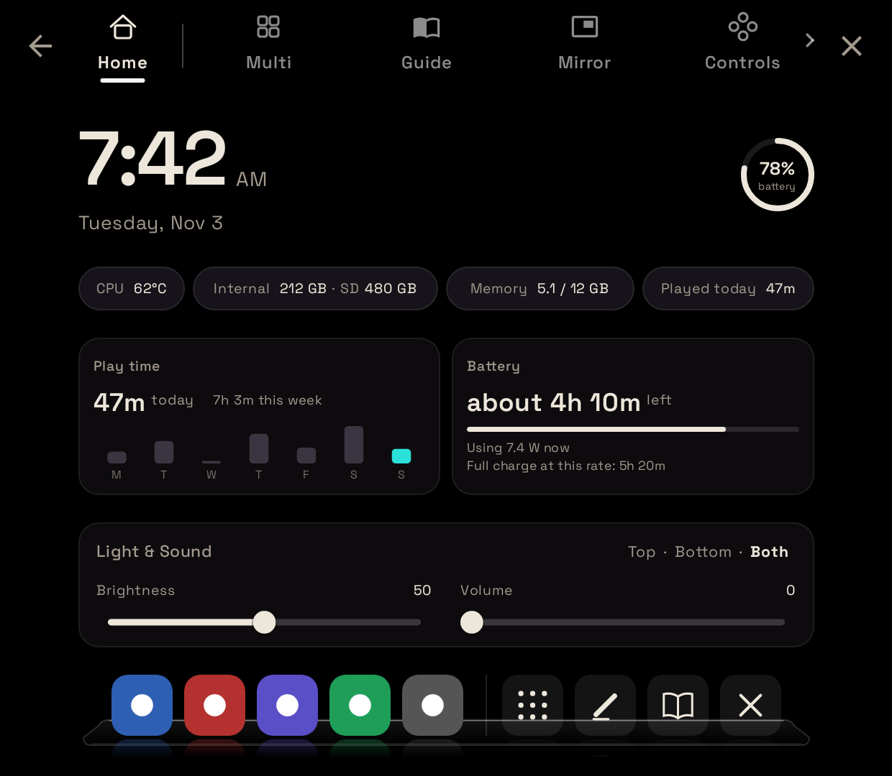
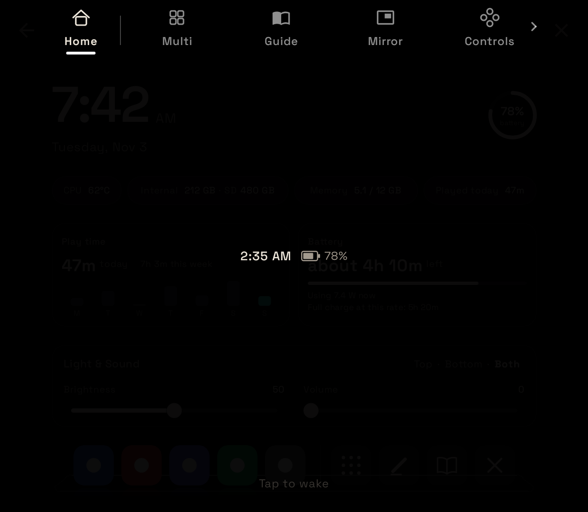
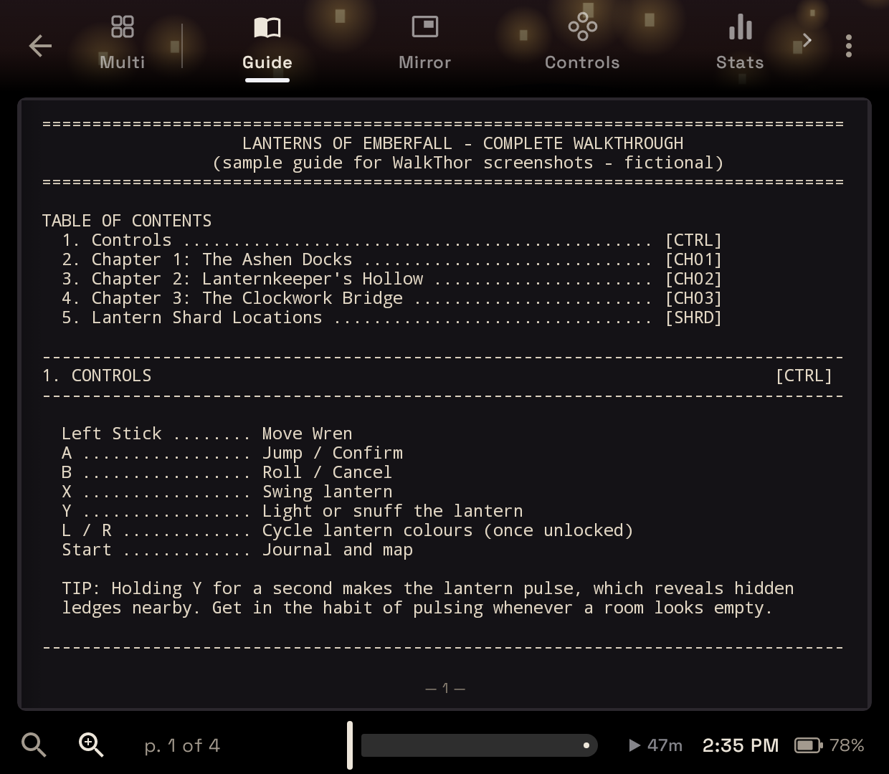
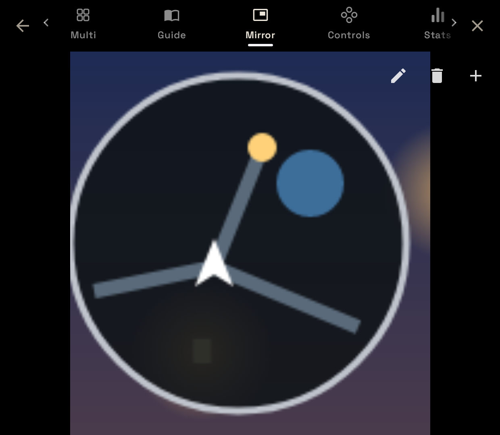
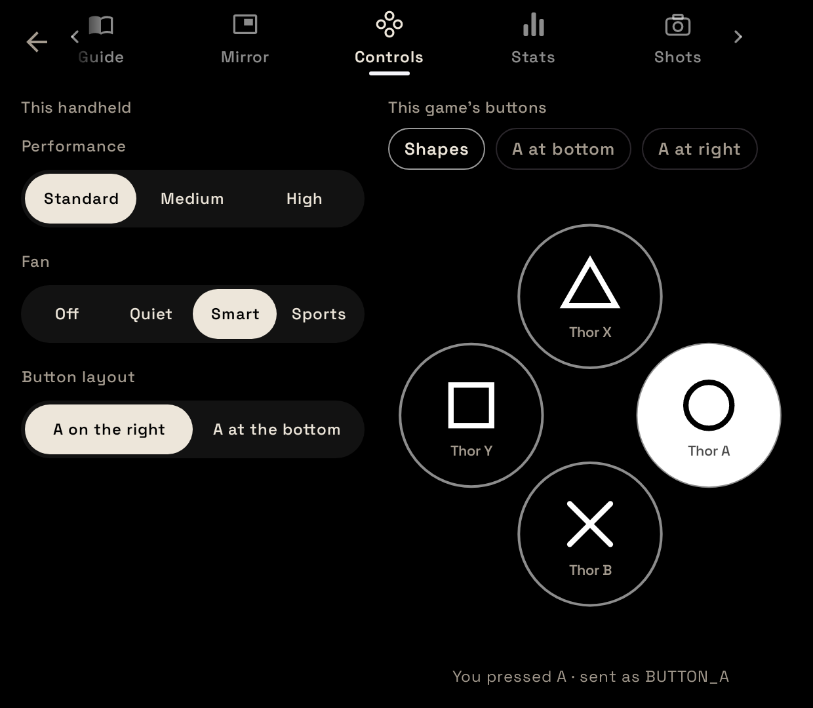
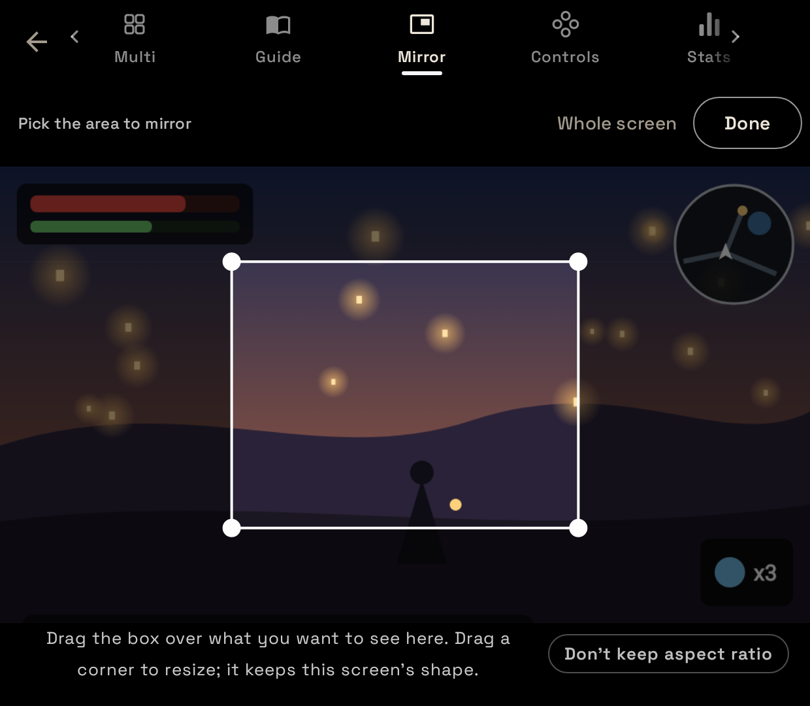
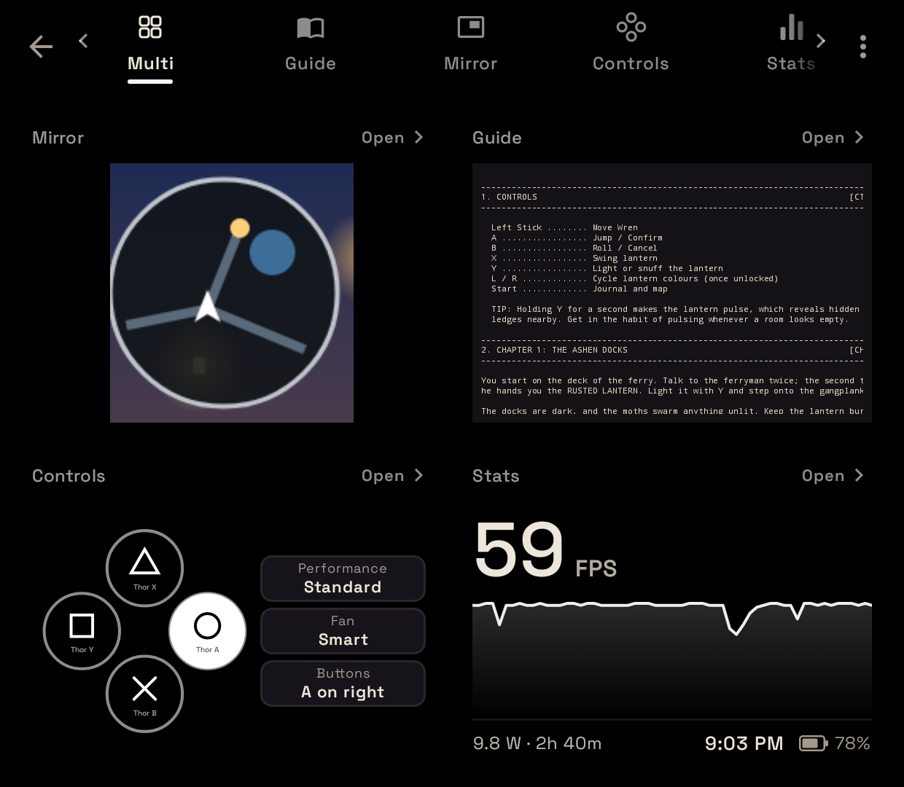
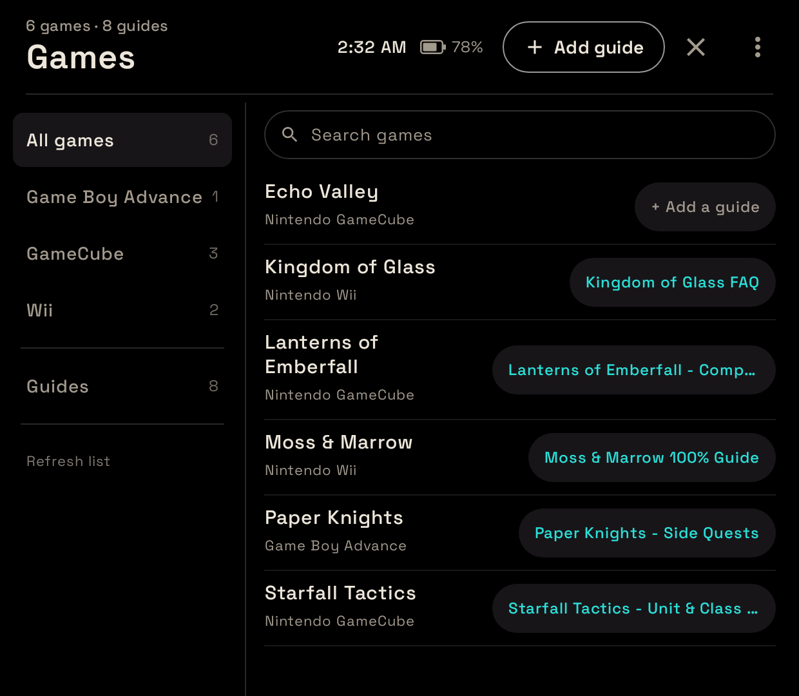

# WalkThor

A companion app for the **AYN Thor**'s bottom screen. Press the AYN button and WalkThor slides up
over the bottom screen like a drawer: a clock, your play time and battery, brightness, volume and
your apps, and, while a game is running, tabs for your guides, a live mirror of part of the top
screen (like a minimap), the face buttons, and a live FPS and battery monitor, while the game keeps
full speed on the top screen. It works with any frontend: it only looks at which app is in front.

> **WalkThor is an independent, unofficial project.** It is not affiliated with, endorsed by or
> supported by AYN or any game publisher.

## Screenshots

Rendered at the Thor bottom screen's 1240×1080 with a fictional sample game and guide.

| | |
|---|---|
|  |  |
|  |  |
|  |  |
|  |  |
|  |  |

## Quick start

1. **Install** the APK from the [latest release](https://github.com/nerf-herder-29/WalkThor/releases/latest)
   (allow "Install unknown apps" for your browser or file manager).
2. **Allow accessibility access** when WalkThor asks. The drawer, the button shortcuts, the
   performance overlay and the keyboard all run through it, and it keeps the game at full priority.
3. **Set your shortcuts** in Settings (⋮) → Shortcuts: set *AYN button: press* to *Open the drawer*.
4. **Link your ROMs folder** (Settings → Guides), the one with a folder per system, to list your games.
5. **Add guides:** *Add a guide* beside a game, *Add guide* at the top, or *Open with* / *Share* a PDF or TXT.

Every step is also in the app under Settings (⋮) → About → *How to set up WalkThor*, with a tick for each
step that's done.

## Features

- **The drawer** — the AYN button (or whichever button you choose) slides WalkThor up over the bottom
  screen and away again; whatever is underneath stays put. It opens on **Home**: a big clock, device
  stats, your play time this week, battery time left and power draw, brightness, volume and the stick
  lights, and your pinned apps on a shelf dock.
- **Tabs while you play** — while one of your emulators is in front (Settings → Emulators sets which
  apps count), the same Home has a row of tabs above it: **Multi** (several at a glance), **Guide**,
  **Mirror**, **Controls**, **Stats**, **Shots**, **Captions**, **Light & Sound** and **Apps** (swipe
  them sideways to see them all). Press and hold a tab to have the drawer open straight on it.
  It works the same whichever frontend started the game, shortcuts included.
- **Guide asks which guide** — the Guide tab lists your guides each time, newest first; WalkThor
  remembers your place in each.
- **Button shortcuts** — Settings → Shortcuts maps the AYN button's press, double press and hold, Back
  pressed twice, and Back held with a D-pad direction, L1, R1, L2 or R2, to things WalkThor can do: open the drawer, AYN's own drawer,
  dim the bottom screen, turn it off, close all apps, take a screenshot, save the last seconds of play,
  the performance overlay, stick lights, lock the controller to a screen, show or hide the WalkThor keyboard, the trackpad, brightness and volume up and down,
  or step through performance and fan modes. A short rumble confirms each one.
- **Performance overlay** — while a game is in front, a small glass panel in a corner of either
  screen shows the frame rate with a graph of the last 30 seconds, and underneath, taking turns
  every 5 seconds, CPU speed and heat, GPU load and heat, battery draw and time left, and RAM.
- **Pause your home app while you play** — Android's own launcher is home during a game and your
  frontend (Cocoon or any other) is closed, so Android can't keep restarting it and squeezing the
  game's memory. It comes back after you're done.
- **Updates** — in the library's list and one swipe left of the drawer's Home: WalkThor and each of
  your emulators, with the version you have, the newest release and what's new in it, and an Update
  button that downloads it and hands it to Android's installer. WalkThor knows where several
  emulators publish their releases (Dolphin's own site included); for others, paste the release page once. Without the internet,
  it shows what it last found.
- **Trackpad** — a shortcut turns the whole bottom screen into a trackpad for the top one: a pointer
  in your stick-light colour, tap to tap, hold then slide to drag, two fingers to scroll. It works by
  touching the top screen for you, so it's for menus, frontends, browsers and apps (not a PC game's mouse).
- **Notifications on the bottom screen** — switch it on in Settings → General, and Android's pop-up
  banners stop covering your game: each notification drops down on the bottom screen instead (on the
  top screen while the bottom one is off). Needs notification access and Force SELinux off.
- **Your games, by system** — link your ROMs folder and WalkThor lists your games under each system,
  each with its guide beside it (tap to open), or *Add a guide* to pick one of yours or add a file.
  Guides are matched to games by title, and any you pick are remembered.
- **Opens when an emulator starts** — turn on *Open when an emulator starts* (Settings → Emulators) and
  the drawer comes up by itself when an emulator comes to the front.
- **Keeps your game at full speed** — while a game runs, WalkThor never takes Android's top-app
  priority from it. Tapping and reading on the bottom screen leave the game in charge, and after
  WalkThor opens (or you finish a search) it hands priority back with one tap on the top edge of
  the game's screen.
- **Comes back if a heavy game pushes it out** — some demanding games make Android close other
  apps to free memory while they load. If that closes WalkThor during a game, it reopens on the
  bottom screen right away and hands the game its priority back (Settings → About → *About & licences* →
  Diagnostics shows when this happened).
- **RAM saver mode** — during a game, when memory gets tight (under 3 GB free, or falling fast
  as a game loads), the drawer steps down to a plain screen with just the time, battery and free
  memory, using a few MB instead of the drawer's 50 or so. The drawer comes back where you were
  once memory is steady again, or straight away with a tap.
- **Shots** — screenshots of the top screen without leaving your game: the whole screen or just
  the part you frame (kept for each game), saved in Pictures/WalkThor and listed in the tab to view,
  share or delete. **Clip** mode records the top screen with the game's sound: switch on *Keep the
  last* (10 to 60 seconds, held in memory only) and press *Save* after something happens, or press
  *Record* to record from now until you stop. Saved as MP4s in Movies/WalkThor. A red mark next to
  the clock shows while it's on, and it stops when you put WalkThor away.
- **Light & Sound** — each screen's brightness (top, bottom or both) and the volume, in a tab of
  its own and as a Multi panel. The top screen uses Android's brightness (it asks for *Modify system
  settings* once); the bottom screen uses AYN's setting where WalkThor can change it, or dims it.
- **Captions** — what's said in your game, as text on the bottom screen, so you can play with the
  sound down. It captures the game's own sound (never the microphone) and recognises speech on the
  device with [Vosk](https://alphacephei.com/vosk/) (a one-time 40 MB model download, then offline).
- **Mirror** — show part of the top screen, like a minimap or HUD, live on the bottom screen. The
  picking box keeps the bottom screen's shape so the mirror fills it (or resize it freely). Pick
  up to four areas per game, switch between them or see them all side by side, and WalkThor
  remembers them. Uses Android's screen capture (it asks the first time you open Mirror for a
  game, and pauses while you're on another tab); nothing is recorded or saved.
- **Controls** — the Thor's performance mode, fan mode and button layout (the same settings as
  AYN's own drawer), and the four face buttons labelled the way the game's system labels them
  (shapes, or letters with A at the bottom or on the right), picked automatically from the
  emulator, each where its Thor button sits and lighting up as you press it.
- **Multi** — up to four tabs at once: choose from Mirror, your guide where you left off, Controls,
  Stats and your pinned apps (⋮ → *Arrange panels*: pick a shape, then a panel for each space). Tap a panel to open that tab; Back
  returns to Multi. Press and hold a panel and drag it to rearrange them.
- **Apps** — open any app on the bottom screen without leaving the game: Discord, a browser, a
  video. Pin the ones you use most; press and hold an app to open it on the top screen instead.
- **Stats** — the top screen's frame rate with a graph of the last minute (counted from the same
  screen capture as Mirror, so no root or extra apps), the battery's power draw and time left at
  that rate, heat, free memory and CPU speed. It learns how much power each game uses and tells
  you how long that game usually lasts on a full charge.
- **Import PDF or TXT guides** — from *Add guide*, a file manager's *Open with*, or *Share*.
  Guides are copied into the app, so the original file can be moved or deleted.
- **Animated book** — pages turn in 3D around the spine. Drag a page and it follows your finger;
  tap the outer edges to turn. Single page or two-page spread (top bar, or ⋮ during a game).
  - PDFs default to a two-page spread; TXT guides to a single wide page sized to 80 columns so
    GameFAQs-style ASCII tables stay aligned. Text size is adjustable.
- **Reading lens** — the magnifying-glass-with-plus button (or tapping the middle of a page) shows
  the page fit to the full width, zoomable to 500% with − / +, pinch or double-tap.
- **Magnifier loupe** — press and hold on a page, then slide.
- **Search** — results as you type, a list of every matching page with snippets, ▲/▼ to step
  through matches, and highlights on the page (PDFs included). During a game, search and the lens
  sit at the bottom left, so the tab bar stays centred.
- **OLED-friendly** — true black, and Home dims during a game after the time you choose, to the
  darkness you choose, with the tabs and the time still lit.
- **Controller support** — L1/R1 (or D-pad left/right) turn pages, in the book and in the lens.
- **Remembers your place** in every guide, with a page scrubber for big jumps.

## Getting the APK

Download `app-release.apk` from the [latest release](https://github.com/nerf-herder-29/WalkThor/releases/latest)
and sideload it. To get updates automatically, add this repository to
[Obtainium](https://github.com/ImranR98/Obtainium), which installs straight from GitHub releases.

Every push to `main` is also built by GitHub Actions (`.github/workflows/build.yml`); pushing a
tag like `v1.2.3` builds a release with that version's notes from `release-notes/`.

## How it was made

WalkThor was built with a lot of help from AI (Claude). The features, design decisions and
testing on a real Thor are the author's; most of the code was written with AI assistance. All of
it is here to read.

## Building locally

Requires JDK 17 and the Android SDK (API 35).

```sh
./gradlew assembleDebug
# app/build/outputs/apk/debug/app-debug.apk
```

## How it's built

| Area | Approach |
|---|---|
| UI | Kotlin + Jetpack Compose (Material 3) |
| PDF pages | Android's built-in `PdfRenderer`, LRU bitmap cache |
| PDF search | Text of every page is extracted once at import with PdfBox-Android and saved next to the guide; match rectangles are located on demand for highlighting |
| TXT pages | `StaticLayout` pagination in the background; the same layout settings draw each page, so pages never overflow. Reading position is stored as a character offset, so it survives font/layout changes |
| Page turn | `graphicsLayer` `rotationY` around the spine with camera perspective, front/back faces and shading |
| Bottom screen | The smaller of the device's displays; the activity relaunches there with `ActivityOptions.setLaunchDisplayId` |
| Game priority | The window is non-focusable while a game runs; after WalkThor opens, the accessibility service taps the game's screen once (`dispatchGesture` on that display) so Android gives the game top priority back |
| Mirror | `MediaProjection` into a half-size `VirtualDisplay` + `ImageReader`, frames drawn straight from their `HardwareBuffer`; the virtual display is paused while another tab is open |

Source layout:

```
app/src/main/java/com/nerfherder/walkthor/
  MainActivity.kt        intents, app navigation, the game's tabs, keeping the game's priority
  SwipeLaunch.kt         accessibility service: the drawer, the hand-back tap, button presses
  Shortcuts.kt           button shortcuts and what they do
  Revive.kt              reopening WalkThor if Android closes it mid-game
  Mirror.kt              screen-capture session for Mirror
  DisplayHelper.kt       moving between the Thor's screens
  LibraryViewModel.kt    import + shelf
  ReaderViewModel.kt     pagination, search, reading position
  controls/              Face Buttons: layouts per system, button presses
  data/                  Book, BookRepository, TxtPaginator, PdfSource, Search, your ROMs folder
  ui/                    GameTabs, HomeScreen, ReaderScreen, MirrorScreen, ControlsScreen,
                         BookView (flip animation), LibraryScreen, AutoDim, Theme
```

## Notes / known limits

- Scanned PDFs without a text layer display fine but can't be searched (no OCR).
- Password-protected PDFs aren't supported.
- Matches that span a page break in TXT guides aren't found.

## Privacy

WalkThor doesn't collect or share any data. It only goes online once, to download the speech model
for Captions if you ask it to. See [PRIVACY.md](PRIVACY.md);
it doubles as the privacy-policy link for a store listing.

## Publishing notes

- **License:** MIT — see [LICENSE](LICENSE). Open-source components and their licenses are listed in
  [THIRD_PARTY_NOTICES.md](THIRD_PARTY_NOTICES.md) and in the app under Settings → About → *About & licences*.
- **No content is bundled.** Users import their own guides. Keep it that way — guides belong to
  their authors and publishers.
- **Google Play:** Accessibility access (the drawer, the hand-back tap, and button presses for shortcuts and Face Buttons) uses an accessibility service without being an accessibility tool.
  The app shows the required in-app disclosure with Agree / No thanks before the service can run.
  You'd also need to fill in Play Console's accessibility declaration (including a short screen
  recording of that disclosure and the swipe feature) and link PRIVACY.md as the privacy policy.
  None of this applies to GitHub or F-Droid distribution.
