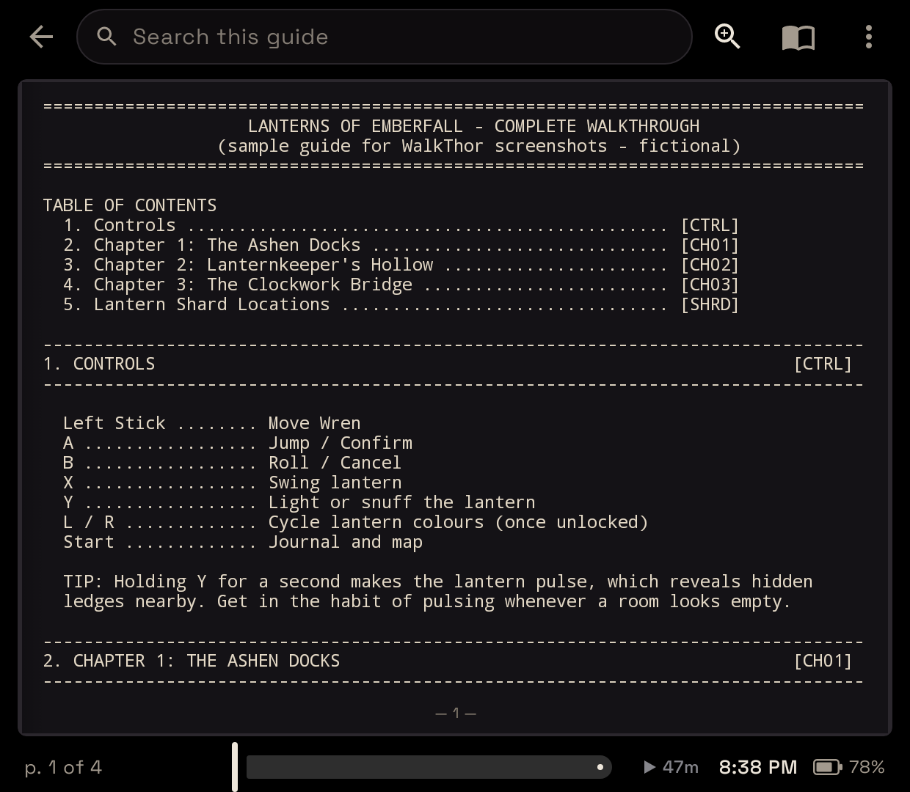
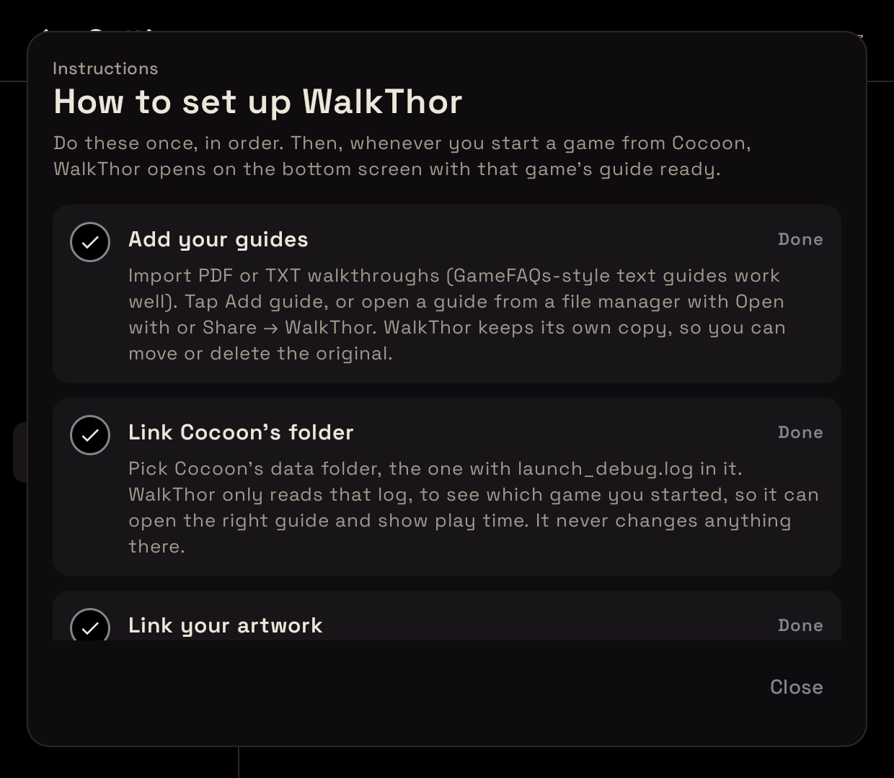

# WalkThor

A walkthrough reader for the **AYN Thor**'s bottom screen. Import a PDF or TXT guide and it
becomes an animated book you can flip through and search while you play on the top screen.
Link Cocoon and WalkThor knows which game you just started, so that game's guide
is one tap away.

> **WalkThor is an independent, unofficial project.** It is not affiliated with, endorsed by or
> supported by Cocoon or its developer, AYN, or any game publisher. It works alongside Cocoon by
> reading a log file Cocoon writes, nothing more.

## Screenshots

Rendered at the Thor bottom screen's 1240×1080 with a fictional sample game and guide.

| | |
|---|---|
|  |  |
|  |  |
|  |  |

## Features

- **Now playing** — start a game in Cocoon (with WalkThor as its companion app) and the bottom
  screen shows the game's hero art and logo, the emulator, and your guide for it. After 5 seconds
  it dims to near-black, with the game's name and an **Open guide** button.
- **Knows your game** — WalkThor reads Cocoon's `launch_debug.log` to see what you launched and
  picks the guide whose title matches. Pick a different one once and it's remembered for that game.
- **Keeps your game at full speed** — while a game runs, WalkThor never takes Android's top-app
  priority from it. Tapping and reading on the bottom screen leave the game in charge, and after
  WalkThor opens (or you finish a search) it hands priority back with one tap on the top edge of
  the game's screen.
- **Mirror** — show part of the top screen, like a minimap or HUD, live on the bottom screen. Pick
  the area once per game and WalkThor remembers it. Uses Android's screen capture (it asks each
  time); nothing is recorded or saved.
- **Import PDF or TXT guides** — from *Add guide*, a file manager's *Open with*, or *Share*.
  Guides are copied into the app, so the original file can be moved or deleted.
- **Animated book** — pages turn in 3D around the spine. Drag a page and it follows your finger;
  tap the outer edges to turn. Single page or two-page spread from the top bar.
  - PDFs default to a two-page spread; TXT guides to a single wide page sized to 80 columns so
    GameFAQs-style ASCII tables stay aligned. Text size is adjustable.
- **Reading lens** — the magnifying-glass button (or tapping the middle of a page) shows the page
  fit to the full width, zoomable to 500% with − / +, pinch or double-tap.
- **Magnifier loupe** — press and hold on a page, then slide.
- **Search** — results as you type, a list of every matching page with snippets, ▲/▼ to step
  through matches, and highlights on the page (PDFs included).
- **Artwork from your folders** — link your artwork folder (Cocoon's media folder works) for guide
  covers, Now playing backgrounds (hero, fan art or screenshots) and game logos.
- **Swipe down to open** — swipe from the top edge of the bottom screen to bring WalkThor up or
  put it away (*Accessibility access* in the ⋮ menu).
- **OLED-friendly** — true black, auto-dim with adjustable delay and darkness, and a status bar
  with the time, battery and how long you've been playing.
- **Controller support** — L1/R1 (or D-pad left/right) turn pages, in the book and in the lens.
- **Remembers your place** in every guide, with a page scrubber for big jumps.
- **Setup instructions built in** — ⋮ → *How to set up WalkThor* walks through every step, with
  a tick for what's done and a button for what isn't.

## Getting the APK

Every push to `main` is built by GitHub Actions (`.github/workflows/build.yml`).
Open the latest run under **Actions → Build APK** and download the `WalkThor-apk` artifact.
Pushing a tag like `v0.1.0` also attaches the APK to a GitHub Release.

Install by sideloading (enable "Install unknown apps" for your file manager on the Thor).

## Building locally

Requires JDK 17 and the Android SDK (API 35).

```sh
./gradlew assembleDebug
# app/build/outputs/apk/debug/app-debug.apk
```

## How it's built

| Area | Approach |
|---|---|
| UI | Kotlin + Jetpack Compose (Material 3) |
| PDF pages | Android's built-in `PdfRenderer`, LRU bitmap cache |
| PDF search | Text of every page is extracted once at import with PdfBox-Android and saved next to the guide; match rectangles are located on demand for highlighting |
| TXT pages | `StaticLayout` pagination in the background; the same layout settings draw each page, so pages never overflow. Reading position is stored as a character offset, so it survives font/layout changes |
| Page turn | `graphicsLayer` `rotationY` around the spine with camera perspective, front/back faces and shading |
| Bottom screen | The smaller of the device's displays; the activity relaunches there with `ActivityOptions.setLaunchDisplayId` |
| Cover art | Images under the linked folder are indexed (no assumed layout) and matched to guide titles by normalized word overlap; covers are copied into the app, loaded with Coil |

Source layout:

```
app/src/main/java/com/nerfherder/walkthor/
  MainActivity.kt        intents, controller keys, app navigation
  DisplayHelper.kt       moving between the Thor's screens
  LibraryViewModel.kt    import + shelf
  ReaderViewModel.kt     pagination, search, reading position
  data/                  Book, BookRepository, TxtPaginator, PdfSource, Search
  ui/                    BookView (flip animation), ReaderScreen, LibraryScreen, PageContent, Theme
```

## Notes / known limits

- Scanned PDFs without a text layer display fine but can't be searched (no OCR).
- Password-protected PDFs aren't supported.
- Matches that span a page break in TXT guides aren't found.

## Privacy

WalkThor doesn't collect, send or share any data and has **no internet permission** (every CI
build checks this). See [PRIVACY.md](PRIVACY.md) — it doubles as the privacy-policy link for a
store listing.

## Publishing notes

- **License:** MIT — see [LICENSE](LICENSE). Open-source components and their licenses are listed in
  [THIRD_PARTY_NOTICES.md](THIRD_PARTY_NOTICES.md) and in the app under ⋮ → *About & licences*.
- **No content is bundled.** Users import their own guides; covers come from their own folders.
  Keep it that way — guides and box art belong to their authors and publishers.
- **Cocoon:** WalkThor is not affiliated with Cocoon. It reads Cocoon's `launch_debug.log` from a folder the user links. It's not an
  official API, so a Cocoon update could change it. Describe this as "works with Cocoon" without
  using Cocoon's logo or implying endorsement.
- **Google Play:** Accessibility access (swipe to open, and the hand-back tap) uses an accessibility service without being an accessibility tool.
  The app shows the required in-app disclosure with Agree / No thanks before the service can run.
  You'd also need to fill in Play Console's accessibility declaration (including a short screen
  recording of that disclosure and the swipe feature) and link PRIVACY.md as the privacy policy.
  None of this applies to GitHub or F-Droid distribution.
