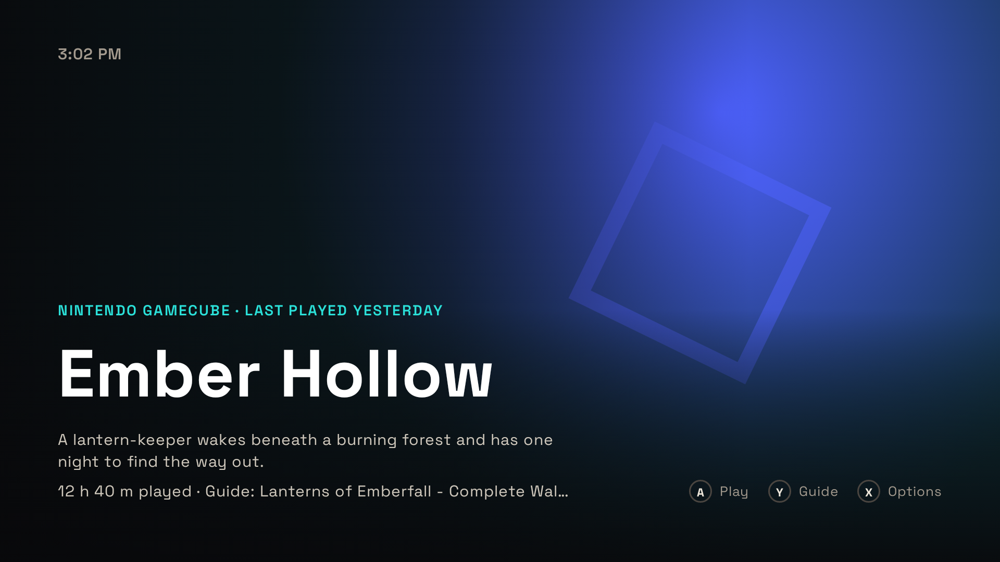
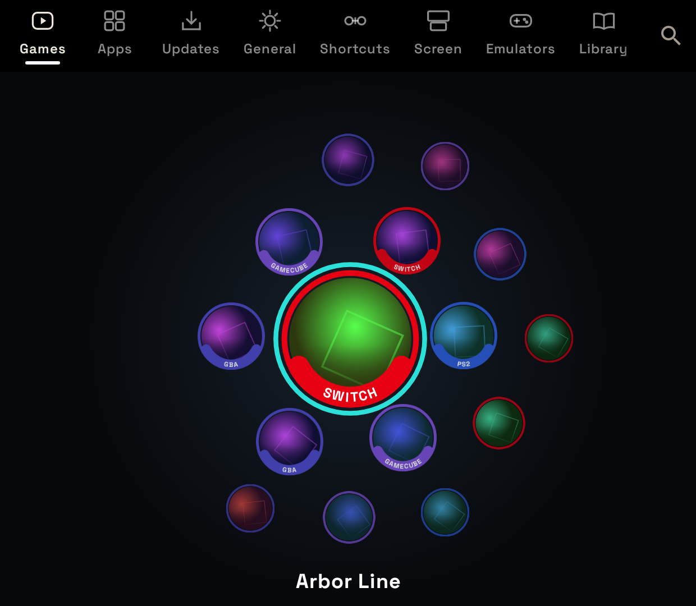
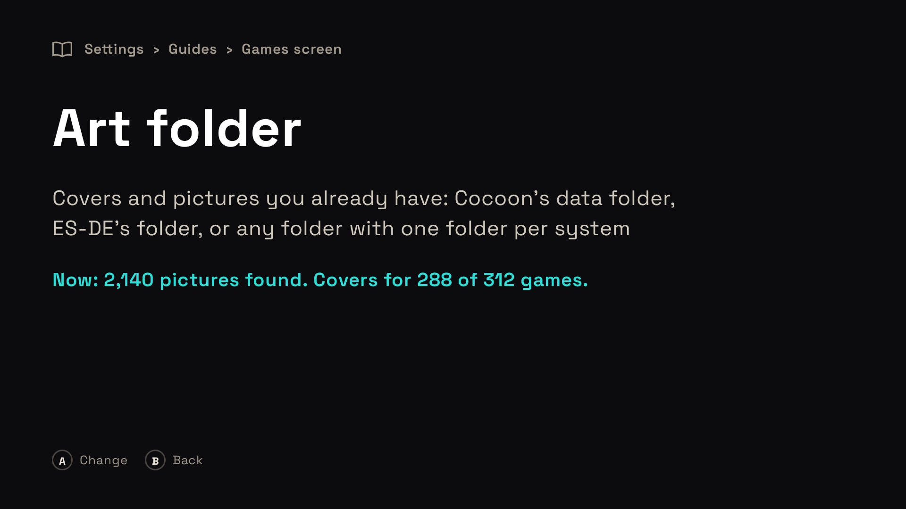
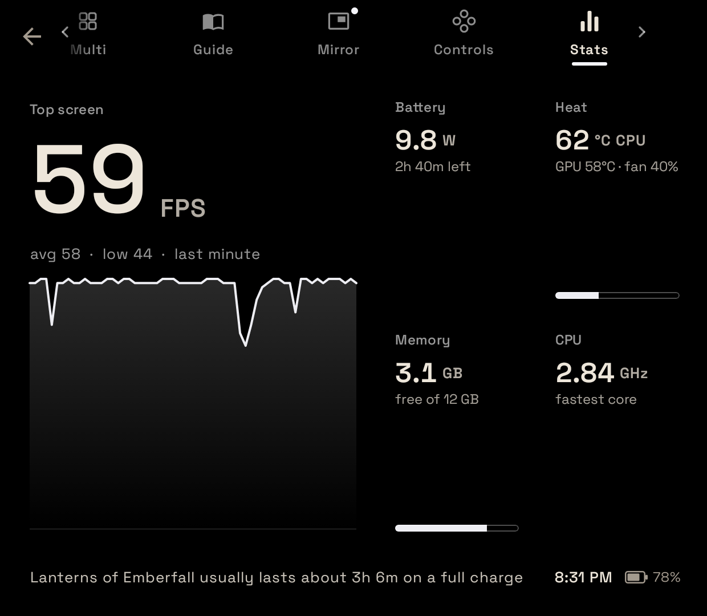
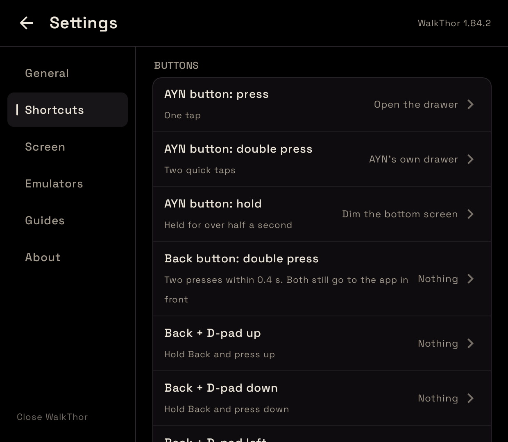

# WalkThor

A dual-screen home screen and game frontend for the **AYN Thor**. Your games sit on the bottom screen
as a cloud of bubbles; the top screen shows the one you're on, with its picture and logo. Press A and
it starts in its emulator on the top screen, while the bottom screen keeps your guide, a live minimap,
your controls and stats a tap away.

> **WalkThor is an independent, unofficial project.** It is not affiliated with, endorsed by or
> supported by AYN, any emulator's developers, or any game publisher. It comes with no games, BIOS
> files or guides: everything it shows comes from your own files.

## Screenshots

Rendered at the Thor's screen sizes with fictional sample games.

| | |
|---|---|
|  |  |
|  |  |
|  |  |
|  |  |

## Setting up

1. **Install** `app-release.apk` from the [latest release](https://github.com/nerf-herder-29/WalkThor/releases/latest)
   (allow "Install unknown apps" for your browser or file manager). To get updates automatically, add this
   repository to [Obtainium](https://github.com/ImranR98/Obtainium), or use WalkThor's own Updates tab.
2. **Allow accessibility access** when WalkThor asks. Button shortcuts, the drawer during a game, knowing when a
   game is running, the performance overlay and the keyboard all run through it. WalkThor explains what it does
   first, then Android asks you to switch it on.
3. **Make WalkThor your home screen:** Android's Settings › Apps › Default apps › Home app › WalkThor. Then the
   Home button takes you to your games, games start on the top screen with WalkThor below, and apps can add their
   game shortcuts to WalkThor.
4. **Link your ROMs folder** (Settings › Library): the folder with one folder per system, named the way
   [ES-DE](https://es-de.org) names them (`gba`, `psx`, `ps2`, `n3ds`, `c64` and so on). WalkThor reads only the
   names, to list your games.
5. **Link your art folder** (optional, Settings › Artwork): covers, backgrounds and logos you already have, such
   as ES-DE's or Cocoon's. *Download missing pictures* fills in the rest, and you can pick your own picture for
   any game.
6. **Check your emulators** (Settings › Emulators › Starting games): for each system, every emulator you have that
   WalkThor can start, and which one it uses.
7. **Add guides** (optional): press X on a game and choose *Add a guide*, or *Open with* / *Share* a PDF or TXT.

Every step is also in the app under Settings › About › *How to set up WalkThor*, with a tick for each step that's
done.

### The controls

| | On your games |
|---|---|
| D-pad / left stick | Move between games |
| Right stick | Look around the cloud without leaving your game |
| A | Play |
| Y | Its guide |
| X | Options: favourite, hide, pictures, guide, and *Start it in…* to pick an emulator for that game |
| L2 / R2 | Jump to the next letter |
| L1 / R1 | Change tab: Games, Apps, Updates, Controllers, then Settings |
| Select | Search (B clears it) |
| Back + Select | Put the Thor to sleep |

Everything in WalkThor, Settings and every pop-up included, works with the controller: a ring in your accent
colour shows where you are, and A picks.

## Features

### Your games
- **A cloud of bubbles** on the bottom screen, spiralling out from the game you're on, each ringed in its system's
  colour and label. Flick through with a touch, or use the D-pad; it floats gently and ripples when a game starts.
- **The top screen** shows the highlighted game: its hero picture with the logo in the middle, its system, when
  you last played and for how long, and whether it has a guide. Each game settles in as you move to it, then its
  picture drifts slowly and its logo floats, and tilting the Thor shifts them like looking through a window (all
  of it can be switched off).
- **Starts games in 100+ emulators.** WalkThor's own tested launchers (Eden, Dolphin, ARMSX2, GameNative,
  PokeDaisy) come first, then every Android emulator [ES-DE](https://es-de.org) knows how to start, from its
  published launch rules: standalone emulators and RetroArch with each of its cores. Choose the emulator per
  system, or per game.
- **Well over 100 systems**, using ES-DE's folder names.
- **Shortcuts from emulators:** when WalkThor is your home screen, an emulator's *Add to home screen* adds the game
  to your games, and a game that only starts that way (Banana Native's, say) starts from its shortcut.
- **Pictures** from your own art folder (any layout, ES-DE and Cocoon included), downloaded from SteamGridDB (with
  your free key), ScreenScraper, the libretro thumbnails, or picked by you, per game.
- **Hide games** you don't want to see, **favourites**, **search**, and play time for every game.
- **Background music:** WalkThor's own soft lo-fi tracks, or a folder of yours, while you choose. It fades out when
  a game starts. Soft sounds as you move, too (both can be switched off).

### While you play
- **The bottom screen goes black** during a game (tap it to wake it), unless the game uses both screens or you
  set the drawer to open when a game starts.
- **Home** shows the game you started: its picture and logo, its system and emulator, and how long you've been
  playing. Swipe up for your apps.
- **Tabs** above Home: **Guide** (opens on that game's guide), **Mirror** (part of the top screen, like a minimap,
  live on the bottom screen), **Controls** (performance mode, fan mode, button layout and the face buttons as the
  game's system labels them), **Stats** (frame rate, battery draw and time left, heat, memory), **Shots**
  (screenshots and clips), **Captions** (what's said in the game, as text, recognised on the device), **Light &
  Sound** and **Apps**. **Multi** shows several at once.
- **Button shortcuts** (Settings › Shortcuts): the AYN button's press, double press and hold, Back pressed twice,
  and Back held with a D-pad direction, L1, R1, L2, R2 or Select. Open the drawer, dim or turn off the bottom screen,
  close all apps, screenshot, save the last seconds of play, performance overlay, stick lights, sleep, brightness,
  volume, performance and fan modes, and more.
- **Performance overlay:** frame rate with a graph, CPU and GPU heat and load, battery draw and RAM, in a corner of
  either screen.
- **Keeps your game at full speed:** WalkThor never takes Android's top-app priority from the game, and comes back
  by itself if a heavy game makes Android close it.

### Apps, Updates and Controllers
- **Apps:** every app as a cloud too. Open one on the top or bottom screen, or always the same one.
- **Updates:** each emulator's installed version, the newest release and what's new, and an Update button that
  downloads it and hands it to Android's installer. WalkThor knows where many emulators publish their releases
  (GitHub, Dolphin's and PokeDaisy's own sites); for others, paste the release page once.
- **Controllers:** pair controllers without leaving WalkThor, see which controller a press came from, and use a
  **pair of Joy-Cons as the Thor's own controls**. They join by themselves when both connect, so every emulator
  already set up for the Thor just works with them, with Home as the Thor's Back button and adjustable stick
  sensitivity. **Any other Bluetooth or USB controller** can join the same way, with its face buttons by letter or
  by position. This uses the system helper built into the Thor's firmware, so it needs the Thor's *Force SELinux*
  setting off.

### Guides
- **PDF and TXT guides** with a 3D page turn, single page or two-page spread, a zoomable reading lens, a magnifier,
  search with highlights, and your place remembered in each. TXT guides are laid out at 80 columns, so ASCII
  tables line up.
- Guides are matched to your games by title, and copied into WalkThor so the originals can be moved or deleted.

## Getting the APK

Download `app-release.apk` from the [latest release](https://github.com/nerf-herder-29/WalkThor/releases/latest)
and sideload it, or add this repository to [Obtainium](https://github.com/ImranR98/Obtainium).

Every push is built by GitHub Actions (`.github/workflows/build.yml`); pushing a tag like `v1.2.3` builds a release
with that version's notes from `release-notes/`.

## If something goes wrong

- **A game won't start:** Settings › Emulators › Starting games shows which emulators WalkThor can use for that
  system. Some emulators need permission to your ROMs folder set up inside the emulator first.
- **Anything else:** after a game closes, WalkThor saves a game report (Settings › About › *About & licences* ›
  Diagnostics › *Share game report*). Attach it to an [issue](https://github.com/nerf-herder-29/WalkThor/issues).
- **Joy-Cons:** the Controllers tab's *Check* shows how the Thor sees them; share it with an issue.

## How it was made

WalkThor was built with a lot of help from AI (Claude). The features, design decisions and testing on a real Thor
are the author's; most of the code was written with AI assistance. All of it is here to read.

## Building locally

Requires JDK 17 and the Android SDK (API 35).

```sh
./gradlew assembleDebug
# app/build/outputs/apk/debug/app-debug.apk
```

`tools/es-de-rules.py <path to an ES-DE checkout>` regenerates the emulator launch rules
(`app/src/main/assets/launch/es-de.tsv`) and the extra systems (`data/MoreSystems.kt`) from ES-DE's own files.

## How it's built

| Area | Approach |
|---|---|
| UI | Kotlin + Jetpack Compose (Material 3) |
| Two screens | The games run on the top display; WalkThor's main activity on the bottom one, and a second activity on the top one for the spotlight, launched with `ActivityOptions.setLaunchDisplayId` |
| Starting games | Explicit intents per emulator; ES-DE's Android launch rules read at runtime and filled in with the game's document URI or path |
| Pictures | Any folder layout scanned once and indexed by cleaned-up title, with fuzzy matching; downloads cached on the device |
| Joy-Cons | A small program run as `app_process` through the Thor's system helper reads both Joy-Cons' raw reports and feeds the Thor's own controller's input device |
| PDF / TXT guides | Android's `PdfRenderer` with PdfBox-Android for search; `StaticLayout` pagination for TXT |
| Mirror, Stats, Shots | `MediaProjection` into a `VirtualDisplay` + `ImageReader`, paused while another tab is open |

Source layout:

```
app/src/main/java/com/nerfherder/walkthor/
  MainActivity.kt          the bottom screen: tabs, games, the game's tabs, keeping the game's priority
  FrontendTopActivity.kt   the top screen while you choose
  SwipeLaunch.kt           accessibility service: the drawer, button presses, which app is in front
  Shortcuts.kt             button shortcuts and what they do
  AynSystem.kt             the Thor's system helper
  controls/                face buttons, controllers, Joy-Cons (JoyCons, JoyConJoin), Bluetooth pairing
  data/                    ROMs and systems, starting games (GameLaunch, EsDeLaunch), pictures,
                           play time, updates, music, guides
  ui/                      the frontend (Frontend, BubbleCloud), settings, the game's tabs, the reader
```

## Notes / known limits

- Scanned PDFs without a text layer display fine but can't be searched (no OCR).
- Password-protected PDFs aren't supported.
- Joy-Cons pass on their buttons and sticks; Capture, motion and rumble aren't passed on yet.

## Privacy

WalkThor doesn't collect or share any data: no accounts, analytics or ads. It goes online only to check for
updates, to download pictures you ask for, and to download the speech model for Captions. See
[PRIVACY.md](PRIVACY.md).

## Licence and credits

- **Licence:** MIT, see [LICENSE](LICENSE). Open-source components and their licences are listed in
  [THIRD_PARTY_NOTICES.md](THIRD_PARTY_NOTICES.md) and in the app under Settings › About › *About & licences*.
- **Emulator launch rules** come from [ES-DE](https://es-de.org) (MIT licence).
- **No content is bundled.** No games, BIOS files or guides. Keep it that way: guides belong to their authors.
